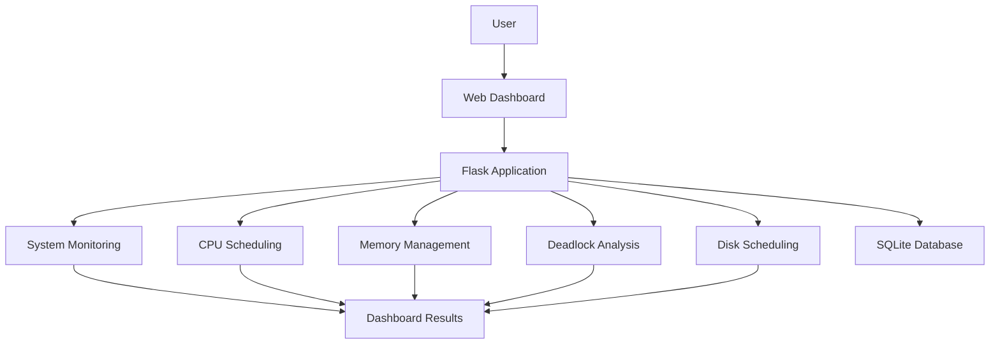

# 🚀 OS Nexus – Operating System Resource Manager

An interactive, web-based Operating System Resource Manager that brings fundamental Operating System concepts to life through algorithm simulations and real-time system monitoring.

## 📌 Project Overview

**OS Nexus** is a Python Flask-based web application designed to demonstrate core Operating System concepts through an interactive dashboard.

It combines theoretical OS algorithms with practical simulations, allowing users to explore CPU scheduling, memory allocation, deadlock detection, disk scheduling, and system resource utilization.

## ✨ Key Features

### 1. 📊 Real-Time System Monitoring
- CPU usage monitoring
- Memory utilization
- Disk usage information
- System information and hardware details

### 2. ⚙️ CPU Scheduling Algorithms
Simulate and compare different CPU scheduling techniques:
- First Come First Serve (FCFS)
- Shortest Job First (SJF)
- Priority Scheduling
- Round Robin

### 3. 💾 Memory Management
Explore different memory allocation strategies:
- First Fit
- Best Fit
- Worst Fit

### 4. 🔒 Deadlock Safety Analysis
Analyze resource allocation using Banker's Algorithm:
- Need Matrix calculation
- Safe sequence identification
- Safe and unsafe state detection

### 5. 💽 Disk Scheduling Algorithms
Simulate disk head movement using:
- First Come First Serve (FCFS)
- Shortest Seek Time First (SSTF)
- SCAN
- C-SCAN

Additional calculations:
- Total head movement
- Average seek movement
- Seek sequence

## 🛠️ Technologies Used

| Technology | Purpose |
|---|---|
| Python | Backend programming |
| Flask | Web application framework |
| HTML5 | Frontend structure |
| CSS3 | Styling and responsive design |
| JavaScript | Interactive dashboard |
| SQLite | User data storage |
| psutil | System resource monitoring |

## 🏗️ Project Architecture



## 📂 Project Structure

```text
OS_Nexus/
│
├── data/
├── scripts/
├── static/
│   ├── css/
│   └── js/
│       └── app.js
│
├── templates/
│   ├── index.html
│   ├── login.html
│   ├── register.html
│   └── profile.html
│
├── tests/
├── app.py
├── modules.py
├── requirements.txt
├── .gitignore
├── README.md
├── REPORT.md
└── SUBMISSION_CHECKLIST.md
```

## ⚡ Installation and Execution

### Prerequisites
- Python 3.9 or later
- Git
- Web browser

### Step 1: Clone the Repository

```bash
git clone https://github.com/sakshi633/OS_Nexus.git
```

### Step 2: Navigate to the Project

```bash
cd OS_Nexus
```

### Step 3: Create a Virtual Environment

```bash
python3 -m venv venv
```

### Step 4: Activate the Virtual Environment

**macOS / Linux:**

```bash
source venv/bin/activate
```

**Windows:**

```bash
venv\Scripts\activate
```

### Step 5: Install Dependencies

```bash
python -m pip install -r requirements.txt
```

### Step 6: Run the Application

```bash
python app.py
```

### Step 7: Open in Browser

```text
http://127.0.0.1:5001
```

Register or log in to access the OS Nexus dashboard.

## 🎯 Project Objectives

- Understand fundamental Operating System concepts practically.
- Visualize CPU scheduling and disk scheduling algorithms.
- Compare memory allocation techniques.
- Analyze deadlock conditions using Banker's Algorithm.
- Monitor system resources through a web-based dashboard.
- Connect theoretical knowledge with practical implementation.

## 🔮 Future Enhancements

- Advanced algorithm comparison and visualization.
- Performance analytics and graphical reports.
- More CPU and disk scheduling algorithms.
- Enhanced system monitoring.
- Improved dashboard customization.

## 👩‍💻 Author

**Sakshi Garg**

B.Tech – Computer Science and Engineering

GitHub: [@sakshi633](https://github.com/sakshi633)

## 📜 Conclusion

OS Nexus provides an interactive approach to learning and understanding Operating System concepts. By combining algorithm simulations with real-time system monitoring, it makes resource management concepts easier to explore and understand.

---

⭐ If you find this project useful, consider giving the repository a star!
